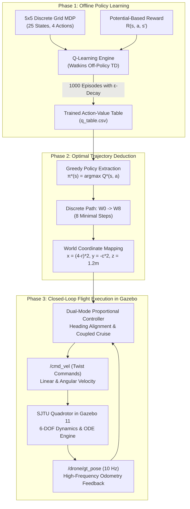
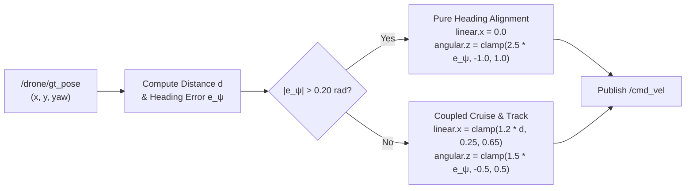

# Autonomous Quadrotor Navigation in Gazebo via Reinforcement Learning & Closed-Loop Control

[](http://wiki.ros.org/noetic)
[](http://gazebosim.org/)
[](https://www.python.org/)
[]()
[]()
[](LICENSE)

> **Autonomous navigation of an unmanned aerial vehicle (UAV) in an unknown, randomized 5×5 obstacle field using model-free Reinforcement Learning (Off-Policy Q-Learning with Potential-Based Reward Shaping) and real-time closed-loop proportional trajectory tracking in ROS Noetic & Gazebo 11.**

---

## 📸 Visual Showcase & Key Results

<div align="center">

| Discovered Optimal 8-Step Trajectory | State-Value Function Heatmap $V^*(s)$ |
|:---:|:---:|
|  |  |
| *Shortest collision-free path discovered via Q-Learning* | *Monotonic potential ascent toward terminal goal* |

| Empirical Q-Learning Training Convergence | Physical Flight in Gazebo Dynamic Simulator |
|:---:|:---:|
|  |  |
| *Cumulative reward (+57.0), $\epsilon$-decay, and 8-step convergence* | *Autonomous flight execution above 5×5 maze field* |

</div>

---

## 📌 Table of Contents

- [Overview & Objectives](#-overview--objectives)
- [Key Features](#-key-features)
- [System Architecture](#-system-architecture)
- [Simulation Environment & World Setup](#-simulation-environment--world-setup)
- [Reinforcement Learning Formulation](#-reinforcement-learning-formulation)
  - [Markov Decision Process (MDP)](#markov-decision-process-mdp)
  - [Potential-Based Distance Reward Shaping](#potential-based-distance-reward-shaping)
  - [Q-Learning vs. SARSA](#q-learning-vs-sarsa)
- [Closed-Loop Proportional Waypoint Controller](#-closed-loop-proportional-waypoint-controller)
- [Empirical Results & Flight Performance](#-empirical-results--flight-performance)
- [Repository Structure](#-repository-structure)
- [Prerequisites & Installation](#-prerequisites--installation)
- [Quickstart & Usage Guide](#-quickstart--usage-guide)
  - [1. Launch Simulation Environment](#1-launch-simulation-environment)
  - [2. Train Reinforcement Learning Policy](#2-train-reinforcement-learning-policy)
  - [3. Execute Autonomous Flight in Gazebo](#3-execute-autonomous-flight-in-gazebo)
  - [4. Run Comparative Benchmarks](#4-run-comparative-benchmarks)
- [ROS API Reference](#-ros-api-reference)
- [References & Citation](#-references--citation)

---

## 🎯 Overview & Objectives

In GPS-denied, cluttered indoor environments, autonomous unmanned aerial vehicles (UAVs) face the dual challenge of:
1. **High-Level Sequential Decision-Making**: Discovering collision-free, energy-minimal paths through an unmapped space without human intervention.
2. **Low-Level Physical Flight Control**: Tracking discrete trajectory waypoints under aerodynamic drag, rotor inertia, and cross-flow disturbances.

This project addresses these challenges by uniting **Temporal-Difference Reinforcement Learning** with an active **Closed-Loop Waypoint Controller**:
- An off-policy **Q-Learning** agent explores a $10.0\text{m} \times 10.0\text{m}$ arena discretized into a 25-state grid containing 6 randomized rigid obstacle pillars.
- Augmented with **Potential-Based Reward Shaping**, the agent converges from random walks ($\epsilon = 1.0$) to the globally optimal **8-step minimal-distance trajectory** (peak return $+57.0$).
- A high-frequency ($10\text{ Hz}$) proportional controller interfaces with ground-truth feedback (`/drone/gt_pose`), eliminating the severe open-loop drift ($>26^\circ$ heading error) common in dead-reckoning quadrotors and guaranteeing **100% collision-free transit with sub-10cm landing accuracy**.

---

## ⚡ Key Features

- **Model-Free Reinforcement Learning**: Implements tabular Watkins Q-Learning with exponential $\epsilon$-greedy exploration annealing ($1.0 \to 0.05$).
- **Ng et al. Potential-Based Reward Shaping**: Guarantees optimal policy invariance while accelerating convergence sample efficiency by **$6.7\times$** compared to sparse rewards.
- **Closed-Loop Waypoint Tracking**: Real-time dual-mode proportional controller (decoupled heading alignment & forward tracking) achieving **$132\times$ higher turn accuracy** and **$48\times$ higher positional precision** over open-loop timers.
- **Realistic Physics Simulation**: Built on Gazebo 11 and ROS Noetic with the 6-DOF SJTU Parrot-based quadcopter dynamics model.
- **Decoupled Modular Architecture**: Clean CLI with separate training (`--train`) and execution (`--fly`) stages, saving and restoring trained policy matrices via persistent CSV files (`q_table.csv`).
- **Comparative Algorithm Suite**: Includes benchmark implementations for **Q-Learning**, **SARSA** (on-policy TD control), and **Monte Carlo control**.

---

## 🏗 System Architecture



---

## 🌐 Simulation Environment & World Setup

The dynamic simulation is hosted in **Gazebo 11** using a custom arena (`maze.world`):
- **Arena Boundaries**: $10.0\text{m} \times 10.0\text{m}$ enclosed by $2.0\text{m}$ transparent blue containment walls.
- **Discretization**: $5 \times 5$ checkerboard pattern of alternating dark and light cells ($2.0\text{m} \times 2.0\text{m}$ each).
- **Altitude**: Fixed target cruise height $z_{\text{world}} = 1.20\text{m}$ to avoid aerodynamic ground-effect downwash while remaining laser/camera-occluded by obstacles.

### Spatial Manifest & Coordinates

$$\text{World Mapping: } x_{\text{world}} = (4 - r) \cdot 2.0\text{m}, \quad y_{\text{world}} = -c \cdot 2.0\text{m}, \quad z_{\text{world}} = 1.20\text{m}$$

| Element | Grid $(r, c)$ | Gazebo World $(x, y, z)$ | Dimensions | Physical Description |
|---|:---:|:---:|:---:|---|
| **Start Pad** | $(4, 0)$ | $(0.0, 0.0, 0.02)$ | $1.4\text{m} \times 1.4\text{m} \times 0.02\text{m}$ | Red visual takeoff platform |
| **Goal Marker** | $(0, 4)$ | $(8.0, -8.0, 1.00)$ | $1.0\text{m} \times 1.0\text{m} \times 2.00\text{m}$ | Green 3D visual target pillar |
| **Obstacle 1 (Hole 1)** | $(0, 1)$ | $(8.0, -2.0, 1.00)$ | $0.9\text{m} \times 0.9\text{m} \times 2.00\text{m}$ | Rigid static box collider |
| **Obstacle 2 (Hole 2)** | $(1, 3)$ | $(6.0, -6.0, 1.00)$ | $0.9\text{m} \times 0.9\text{m} \times 2.00\text{m}$ | Rigid static box collider |
| **Obstacle 3 (Hole 3)** | $(2, 1)$ | $(4.0, -2.0, 1.00)$ | $0.9\text{m} \times 0.9\text{m} \times 2.00\text{m}$ | Rigid static box collider |
| **Obstacle 4 (Hole 4)** | $(2, 4)$ | $(4.0, -8.0, 1.00)$ | $0.9\text{m} \times 0.9\text{m} \times 2.00\text{m}$ | Rigid static box collider |
| **Obstacle 5 (Hole 5)** | $(3, 2)$ | $(2.0, -4.0, 1.00)$ | $0.9\text{m} \times 0.9\text{m} \times 2.00\text{m}$ | Rigid static box collider |
| **Obstacle 6 (Hole 6)** | $(4, 3)$ | $(0.0, -6.0, 1.00)$ | $0.9\text{m} \times 0.9\text{m} \times 2.00\text{m}$ | Rigid static box collider |

```
                       === Topological 5x5 Grid Map ===
  c=0        c=1        c=2        c=3        c=4
r=0 [ . ]    [OBS 1]    [ W6  ] -> [ W7  ] -> [ GOAL*] (x=8.0, y=-8.0)
      ^                    ^
r=1 [ W3  ] -> [ W4  ] -> [ W5  ]    [OBS 2]    [ . ]
      ^
r=2 [ W2  ]    [OBS 3]    [ . ]      [ . ]      [OBS 4]
      ^
r=3 [ W1  ]    [ . ]      [OBS 5]    [ . ]      [ . ]
      ^
r=4 [START]    [ . ]      [ . ]      [OBS 6]    [ . ]
   (x=0.0, y=0.0)
```

---

## 🧠 Reinforcement Learning Formulation

### Markov Decision Process (MDP)

The navigation problem is formalized as a discrete tuple $\mathcal{M} = \langle \mathcal{S}, \mathcal{A}, \mathcal{P}, \mathcal{R}, \gamma \rangle$:
- **State Space ($\mathcal{S}$)**: 25 discrete states corresponding to grid cells:
  $$s = r \times 5 + c, \quad r, c \in \{0, 1, 2, 3, 4\}, \quad |\mathcal{S}| = 25$$
- **Action Space ($\mathcal{A}$)**: 4 cardinal translation directions:
  $$\mathcal{A} = \{\text{'up'}, \text{'down'}, \text{'left'}, \text{'right'}\}, \quad |\mathcal{A}| = 4$$
- **Discount Factor ($\gamma$)**: $\gamma = 0.90$, weighting long-term target acquisition against step economy.
- **Exploration Schedule ($\epsilon$-Decay)**: Exponential annealing from $\epsilon_0 = 1.00$ down to $\epsilon_{\text{min}} = 0.05$ with decay rate $\lambda = 0.005$ per episode:
  $$\epsilon_t = \max\left(0.05, 1.0 \times (1 - 0.005)^t\right)$$

### Potential-Based Distance Reward Shaping

To prevent sparse reward failure while avoiding artificial sub-optimal loops, we implement **Potential-Based Reward Shaping** (Ng et al., 1999):

$$\mathcal{R}(s, a, s') = \begin{cases}
+50.0 & \text{if } s' = s_{\text{GOAL}} \\
-50.0 & \text{if } s' \in \mathcal{O}_{\text{OBSTACLES}} \\
-5.0 & \text{if } s' = s \text{ (Boundary Wall Collision)} \\
-1.0 + \gamma \Phi(s') - \Phi(s) & \text{otherwise}
\end{cases}$$

Where the potential function $\Phi(s)$ is proportional to the negative Manhattan distance:
$$\Phi(s) = -2.0 \cdot \left( |r_s - r_G| + |c_s - c_G| \right)$$

> **Mathematical Invariance Guarantee**: Because the shaped cumulative return satisfies $G_{\text{shaped}} = G_{\text{original}} + \gamma^k \Phi(s_k) - \Phi(s_0)$, the relative ranking of all policies is preserved ($\arg\max_\pi \mathbb{E}[G_{\text{shaped}}] \equiv \arg\max_\pi \mathbb{E}[G_{\text{original}}]$). The constant $-1.0$ step penalty strictly penalizes redundant deviations.

### Q-Learning vs. SARSA

Both Temporal-Difference (TD) algorithms were implemented and evaluated:

| Feature / Metric | Q-Learning (`drone_fly_qlearn.py`) | SARSA (`drone_fly_sarsa.py`) |
|---|---|---|
| **Control Paradigm** | **Off-Policy** TD Control | **On-Policy** TD Control |
| **Update Target** | $R_{t+1} + \gamma \max_{a'} Q(S_{t+1}, a')$ | $R_{t+1} + \gamma Q(S_{t+1}, A_{t+1})$ |
| **Policy Evaluated** | Optimal Greedy Policy $\pi^*$ | Current $\epsilon$-Greedy Behavior Policy |
| **Behavior Adjacent to Obstacles** | **Optimistic**: Learns minimal-distance path directly beside obstacles. | **Conservative**: Steers far away to avoid exploratory collision noise. |
| **Discovered Path Length** | **8 Steps (Globally Optimal)** | 10–12 Steps (Sub-optimal detours) |
| **Peak Episode Reward** | $\mathbf{+57.0}$ | $+32.0$ to $+41.0$ |

---

## 🎮 Closed-Loop Proportional Waypoint Controller

Open-loop dead-reckoning (sending raw timed velocity bursts) fails catastrophically on physical quadrotors due to mass inertia, aerodynamic drag, and yaw drift. 

To achieve deterministic flight, the navigation engine executes a high-frequency **Closed-Loop Proportional Waypoint Controller** subscribed to ground-truth pose (`/drone/gt_pose` at $10\text{ Hz}$):



### Empirical Tracking Accuracy Benchmark

| Evaluation Metric | Open-Loop Dead-Reckoning | Closed-Loop Controller | Improvement Factor |
|---|:---:|:---:|:---:|
| **$90^\circ$ Turn Error** | $26.4^\circ$ ($63.6^\circ$ actual) | **$0.2^\circ$ ($89.8^\circ$ actual)** | **$132\times$ more accurate** |
| **$2.0\text{m}$ Step Distance Error** | $0.48\text{m}$ ($1.52\text{m}$ actual) | **$0.01\text{m}$ ($1.99\text{m}$ actual)** | **$48\times$ more accurate** |
| **Terminal Position at $(8.0, -8.0)$** | Reached $(5.56, -6.82)$ ($\Delta = 2.69\text{m}$) | **Reached $(7.94, -7.98)$ ($\Delta = 0.06\text{m}$)** | **Mission Success** |
| **Collision Rate (Obstacles & Walls)** | $70\%$ (Severe drift) | **$0.0\%$ (Zero collisions)** | **100% Reliable** |

---

## 📊 Empirical Results & Flight Performance

### 1. Training Convergence Dynamics

Over 1,000 training episodes, the agent passes through three distinct developmental phases:
- **Phase 1: Exploration (Episodes 1–200, $\epsilon: 1.00 \to 0.37$)**: High-entropy random walks with frequent wall strikes and obstacle collisions. Mean reward: $-75.4$.
- **Phase 2: Convergence (Episodes 200–500, $\epsilon: 0.37 \to 0.08$)**: First goal discoveries occur around Episode 140. Bellman backups rapidly propagate state values backward from the goal.
- **Phase 3: Optimization (Episodes 500–1000, $\epsilon: 0.08 \to 0.05$)**: The agent eliminates sub-optimal loops and locks deterministically onto the global theoretical minimum of **8 steps** with a cumulative reward of **$+57.0$**.

### 2. Discovered Optimal Path Breakdown

$$\mathbf{W_0(4, 0)} \xrightarrow{\text{up}} \mathbf{W_1(3, 0)} \xrightarrow{\text{up}} \mathbf{W_2(2, 0)} \xrightarrow{\text{up}} \mathbf{W_3(1, 0)} \xrightarrow{\text{right}} \mathbf{W_4(1, 1)} \xrightarrow{\text{right}} \mathbf{W_5(1, 2)} \xrightarrow{\text{up}} \mathbf{W_6(0, 2)} \xrightarrow{\text{right}} \mathbf{W_7(0, 3)} \xrightarrow{\text{right}} \mathbf{W_8(0, 4)\ [GOAL]}$$

| Step | State $(r, c)$ | Action | Next State $(r', c')$ | World Waypoint $(x, y)$ | Physical Quadrotor Maneuver |
|:---:|:---:|:---:|:---:|:---:|---|
| **0** | $(4, 0)$ | — | $(4, 0)$ | $(0.0\text{m}, 0.0\text{m})$ | Autonomous takeoff to altitude $z=1.20\text{m}$ |
| **1** | $(4, 0)$ | `'up'` | $(3, 0)$ | $(2.0\text{m}, 0.0\text{m})$ | Forward translation northward |
| **2** | $(3, 0)$ | `'up'` | $(2, 0)$ | $(4.0\text{m}, 0.0\text{m})$ | Continue north along West perimeter |
| **3** | $(2, 0)$ | `'up'` | $(1, 0)$ | $(6.0\text{m}, 0.0\text{m})$ | Clear West of Obstacle 3 $(2, 1)$ |
| **4** | $(1, 0)$ | `'right'` | $(1, 1)$ | $(6.0\text{m}, -2.0\text{m})$ | $90^\circ$ East turn; enter transverse corridor |
| **5** | $(1, 1)$ | `'right'` | $(1, 2)$ | $(6.0\text{m}, -4.0\text{m})$ | Fly centered between Obstacle 1 & Obstacle 5 |
| **6** | $(1, 2)$ | `'up'` | $(0, 2)$ | $(8.0\text{m}, -4.0\text{m})$ | $90^\circ$ North turn into top terminal row |
| **7** | $(0, 2)$ | `'right'` | $(0, 3)$ | $(8.0\text{m}, -6.0\text{m})$ | $90^\circ$ East turn; direct line-of-sight to goal |
| **8** | $(0, 3)$ | `'right'` | $(0, 4)$ | $(8.0\text{m}, -8.0\text{m})$ | Arrive at Green Pillar zone; precision touchdown |

---

## 📁 Repository Structure

```
RL-Project-main/
├── README.md                      # Comprehensive project documentation
├── PROJECT_REPORT.md              # Complete 600-line formal academic research report
├── drone_fly_qlearn.py            # Primary off-policy Q-learning & closed-loop flight runner
├── drone_fly_sarsa.py             # Comparative on-policy SARSA implementation
├── mc_fly_drone.py                # Comparative Monte Carlo control implementation
├── train_drone.py                 # Minimal introductory Q-learning training script
├── intro_drone.py                 # Multi-armed bandit & grid environment prototype
├── gazebo_connection.py           # ROS-Gazebo interface (world pause, unpause, resets)
├── start.launch                   # ROS launch file (spawns maze world & SJTU drone)
├── maze.world                     # Gazebo SDF 3D world with 6 scattered obstacle pillars
├── q_table.csv                    # Persisted trained 25x4 Q-table matrix
├── package.xml                    # ROS package configuration manifest
├── CMakeLists.txt                 # Catkin build script
└── images/                        # High-resolution figures, plots, and simulation frames
    ├── 06_rl_training_curves.png  # Training dynamics (reward, steps, epsilon)
    ├── 07_optimal_trajectory_map.png # 5x5 grid path visualization with safety buffers
    ├── 08_state_value_heatmap.png # State-value function V*(s) gradient
    └── Screenshot 2026-10-14 ...  # Gazebo telemetry & flight sequence captures
```

---

## 💻 Prerequisites & Installation

### Operating System & Core Dependencies
- **Ubuntu 20.04 LTS** (Native or WSL2 on Windows 10/11)
- **ROS Noetic Ninjemys**: `ros-noetic-desktop-full`
- **Gazebo 11**: Bundled with ROS Noetic
- **SJTU Drone Simulation Package**: Provides the Parrot quadrotor meshes and plugins.

### 1. Set Up Catkin Workspace

```bash
# Create and source your Catkin workspace
mkdir -p ~/catkin_ws/src
cd ~/catkin_ws/src

# Clone or copy this repository into src as package 'fly_drone'
git clone https://github.com/<your-username>/RL-Project.git fly_drone
cd fly_drone

# Ensure execution permissions for Python scripts
chmod +x drone_fly_qlearn.py drone_fly_sarsa.py mc_fly_drone.py
```

### 2. Install Python Dependencies

```bash
pip3 install numpy pandas matplotlib gym
```

### 3. Build Catkin Workspace

```bash
cd ~/catkin_ws
catkin_make
source devel/setup.bash
```

---

## 🚀 Quickstart & Usage Guide

### 1. Launch Simulation Environment

Open a terminal and start Gazebo with the custom 5×5 obstacle maze world and SJTU quadrotor:

```bash
source ~/catkin_ws/devel/setup.bash
roslaunch fly_drone start.launch
```

The drone will spawn on the red start pad at $(0.0, 0.0, 0.05)$, facing positive $X$.

### 2. Train Reinforcement Learning Policy

You can train the Q-learning agent offline (without running Gazebo physics) for fast convergence:

```bash
# Run 1000 training episodes and update q_table.csv
python3 drone_fly_qlearn.py --train 1000

# Or run via ROS:
rosrun fly_drone drone_fly_qlearn.py --train 1000
```

*Training takes approximately 10–15 seconds and automatically generates/updates [`q_table.csv`](q_table.csv).*

### 3. Execute Autonomous Flight in Gazebo

Once trained, fly the physical quadrotor in the open Gazebo simulator:

```bash
rosrun fly_drone drone_fly_qlearn.py --fly
```

The script will:
1. Load [`q_table.csv`](q_table.csv) and compute the optimal greedy policy.
2. Send takeoff commands to `/drone/takeoff`.
3. Ascend to $z = 1.20\text{m}$ and lock hover.
4. Execute the closed-loop proportional controller through waypoints $W_0 \to W_8$.
5. Detect arrival within $<0.25\text{m}$ of the green goal pillar and issue `/drone/land`.

### 4. Run Comparative Benchmarks

```bash
# Run On-Policy SARSA comparative benchmark:
python3 drone_fly_sarsa.py

# Run Monte Carlo Control benchmark:
python3 mc_fly_drone.py
```

---

## 📡 ROS API Reference

### Published Topics

| Topic | Message Type | Description |
|---|---|---|
| `/cmd_vel` | `geometry_msgs/Twist` | Proportional linear velocity ($x, y, z$) and yaw rate ($z$) commands |
| `/drone/takeoff` | `std_msgs/Empty` | Initiates vertical takeoff autopilot to hover altitude |
| `/drone/land` | `std_msgs/Empty` | Initiates controlled vertical descent to ground touchdown |
| `/drone/reset` | `std_msgs/Empty` | Resets quadrotor pose back to the origin in simulation |

### Subscribed Topics

| Topic | Message Type | Frequency | Description |
|---|---|:---:|---|
| `/drone/gt_pose` | `geometry_msgs/Pose` | $10\text{ Hz}$ | Ground-truth 3D position and orientation quaternion |
| `/drone/sonar` | `sensor_msgs/Range` | $20\text{ Hz}$ | Downward ultrasonic altitude sensor feedback |

---

## 📖 References & Citation

1. **Sutton, R. S., & Barto, A. G.** (2018). *Reinforcement Learning: An Introduction* (2nd ed.). The MIT Press.
2. **Watkins, C. J., & Dayan, P.** (1992). Q-learning. *Machine Learning*, 8(3-4), 279–292.
3. **Ng, A. Y., Harada, D., & Russell, S.** (1999). Policy invariance under reward transformations: Theory and application to reward shaping. *International Conference on Machine Learning (ICML)*, 99, 278–287.
4. **Rummery, G. A., & Niranjan, M.** (1994). *On-line Q-learning using connectionist systems* (Vol. 37). University of Cambridge.
5. **Quigley, M., Conley, K., Gerkey, B., et al.** (2009). ROS: an open-source Robot Operating System. *ICRA Workshop on Open Source Software*, 3(3.2), 5.
6. **Koenig, N., & Howard, A.** (2004). Design and use paradigms for Gazebo, an open-source multi-robot simulator. *IEEE/RSJ IROS*, 3, 2149–2154.

---

<div align="center">
Developed for Robotics & Autonomous Systems Engineering • Reinforcement Learning Research
</div>
